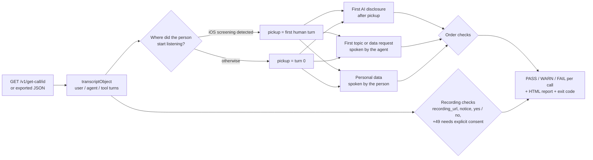

# firstturn

**Did the person on the phone hear "AI" before the conversation turned to their contract, their bill or their data?**

A script check can confirm the configured greeting discloses the AI in its first sentences. But the EU AI Act transparency rules (in force for voice agents since 2 August 2026) are about what the *person* heard, and live calls drift from the script:

- the caller speaks first, and the agent answers the question before introducing itself
- iOS call screening hears the greeting, and the person who picks up afterwards does not
- the caller talks over "ich bin eine..." and the agent never repeats it
- the agent asks for a date of birth "before we start"
- someone asks "sind Sie ein echter Mensch?" and gets a friendly non-answer
- a German number is recorded without an explicit yes, or after a no

firstturn reads finished calls in the exact shape of telli's `GET /v1/get-call/{id}` and checks each one, turn by turn.



## Checks

| Code | Level | Fires when |
| --- | --- | --- |
| `topic-before-disclosure` | FAIL | the agent mentions the topic (contract, Rechnung, Termin...) or asks for data before saying it is an AI, including in the same breath |
| `data-before-disclosure` | FAIL | the person says an IBAN, birth date, customer number, email or address before hearing it is an AI |
| `disclosed-to-screener` | FAIL | the only disclosure was spoken to iOS call screening |
| `disclosure-cut-off` | FAIL | the greeting stopped mid-disclosure and it was never repeated |
| `no-disclosure` | FAIL | no disclosure anywhere |
| `asked-not-told` | FAIL | "are you a robot / sind Sie ein Mensch?" and the next answer does not say AI |
| `recorded-no-notice` | FAIL | `recording_url` exists and recording was never announced |
| `recorded-after-refusal` | FAIL | the person said no and a recording exists |
| `recorded-no-consent` | FAIL | German number, recording announced, no clear yes |
| `recording-notice-late` | WARN | recording announced after the topic started |
| `outside-first-four` | WARN | disclosure came later than the fourth spoken sentence, though still before the topic |
| `voicemail-no-disclosure` | WARN | a voicemail message that never says it is an AI |

## Run it

No dependencies, Python 3.9+.

```bash
python3 firstturn.py demo/calls.json --html demo/report.html
```

```bash
TELLI_API_KEY=... python3 firstturn.py --fetch <call-id> <call-id> --html report.html
```

It exits 1 when any call fails, so it can gate an agent release: replay last week's calls against a changed greeting and block the publish if the fail rate goes up.

`demo/calls.json` holds 18 synthetic calls (German and English) covering every check; `python3 test_firstturn.py` asserts the expected verdict for each.

## Limits

- Detection is pattern-based (EN and DE phrase lists), so it is explainable and deterministic, and it will miss creative paraphrases. The next step is a small classifier for the agent turns the patterns are unsure about, scored against a labelled set of real calls.
- The transcript has no timestamps, so a barge-in is inferred from a greeting that stops mid-sentence.
- A brand name that contains a topic word ("... Insurance") can trigger the topic check; pass brand names to an ignore list before running it on real accounts.
- Not legal advice. It flags calls for a person to review.
